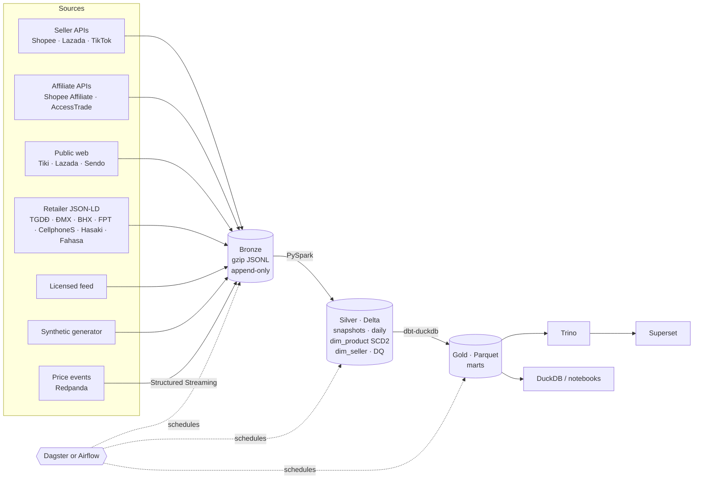

# vn-ecom-data-platform

> Picking this up? Start with [HANDOFF.md](HANDOFF.md).

Template data platform for tracking Vietnamese e-commerce — marketplaces **Shopee, Lazada, Tiki, TikTok Shop,
Sendo** and retailers **Thế Giới Di Động, Điện Máy Xanh, Bách Hóa Xanh, FPT Shop, CellphoneS, Hasaki, Fahasa** —
prices, discounts, sold counts, sellers and campaigns (1.1 → 12.12, payday, Tết, Black Friday).

Medallion lake on **PySpark + Delta**, gold marts in **dbt (DuckDB)**, orchestrated by **Dagster _or_ Airflow 3**,
with **MinIO, Trino, Superset and Redpanda streaming** in the bigger tiers. Runs end-to-end on synthetic data
with zero credentials, so it works the moment you clone it.



## Tiers

"Tier" means three things here, and all three are first-class:

| | What | Where it lives |
|---|---|---|
| **Data tiers** | `bronze` raw → `silver` cleaned/typed/deduped → `gold` business marts | `lake/` (local) or `s3://vnecom-lake` (MinIO) |
| **Deploy tiers** | `lite` · `standard` · `full` | `make demo` / `make up TIER=…` |
| **Source tiers** | `official` · `licensed` · `public` · `synthetic` — carried on every row as `source_tier` | `config/platforms.yaml` |

| Deploy tier | Runs | Needs |
|---|---|---|
| **lite** | local venv: PySpark `local[*]`, dbt-duckdb, Dagster dev UI | Python 3.11+, Java 17+ |
| **standard** | Docker: MinIO, Postgres, Spark master/worker, **Dagster** *or* **Airflow 3** | Docker, ~6 GB RAM |
| **full** | standard + Trino, Superset, Redpanda, price producer, Spark streaming job | ~10 GB RAM |

## Quick start (lite)

```bash
make install          # .venv with spark + dbt + dagster + dev extras
make demo DAYS=45     # synthetic 45 days -> bronze -> silver -> gold, prints GMV by platform
make dagster-dev      # http://localhost:3000 — full lineage bronze -> silver -> gold
```

Ad-hoc questions:

```bash
.venv/bin/vnecom query "select * from gold.fct_fake_discounts where is_pre_campaign_hike order by displayed_discount_pct desc limit 20"
.venv/bin/vnecom query "select campaign_id, platform, round(gmv_uplift_x_exact,2) from gold.mart_campaign_uplift where campaign_kind='double_day'"
```

Offline / no Maven access? set `VNECOM_TABLE_FORMAT=parquet` — same pipeline, Parquet instead of Delta.

## Containers (standard / full)

```bash
cp .env.example .env           # change the passwords
make up TIER=standard ORCH=dagster     # Dagster :3000 · Spark :8081 · MinIO :9001
make up TIER=full ORCH=airflow         # Airflow :8080 · Trino :8085 · Superset :8088
make trino-register                    # after the first run: expose silver + gold in Trino
```

Pick **one** orchestrator per lake — both drive the same `vnecom` CLI, so switching never touches pipeline code.

| | Dagster | Airflow 3 |
|---|---|---|
| Unit of work | assets (bronze/silver/gold lineage incl. every dbt model) | DAGs of `vnecom …` tasks |
| Capture cadence | `regular_capture` 09:07 + 21:07 ICT, `campaign_capture` every 2h on campaign days | `vnecom_capture`, `vnecom_campaign_capture` (short-circuits off-campaign) |
| Gold refresh | eager automation once silver lands | `vnecom_gold` scheduled on the silver `Asset` |
| DQ | silver checks surface as asset checks | silver exits 2 on failed DQ → gold never builds |

## What's in gold

| Mart | Answers |
|---|---|
| `fct_listing_daily` | per listing per day: close/min/max price, displayed discount, **estimated units & GMV**, campaign |
| `fct_fake_discounts` | **"nâng giá rồi giảm"** — advertised discount vs real discount against the lowest price in the prior 30 days (EU-Omnibus rule); pre-campaign price-hike flag; confidence by history depth |
| `mart_campaign_uplift` | campaign vs pre-campaign baseline GMV per platform × category (`gmv_uplift_x_exact` uses exact-counter listings only — see below) |
| `mart_platform_daily` | listings, sellers, GMV, GMV share, official-store share, stockout rate |
| `mart_category_share` | weekly category share within and across platforms |
| `mart_seller_leaderboard` | rolling-30-day seller ranking + count of fake-discount listings |
| `mart_cross_platform_price` | same product on 2+ platforms today: cheapest platform, premium vs best, marketplace vs retailer (TGDĐ/FPT/Hasaki…) gap |

**About sold counts.** Shopee/Lazada/TikTok show bucketed counters (`Đã bán 1,2k`, `10k+`) that only move at
thresholds. Silver flags them (`sold_count_is_bucketed`); gold spreads each bucket jump over the days since the
last move, which *dampens* spikes. That's why uplift ships twice: `gmv_uplift_x` (all listings, lower bound) and
`gmv_uplift_x_exact` (Tiki/Sendo/sub-1k/own-shop exact counters). On the synthetic data, 10.10 shows ~1.0× on
bucketed platforms vs ~4.3× exact — the planted truth is ~5×.

## Sources

Enable any mix with `VNECOM_SOURCES` (comma-separated). Every row keeps `source` and `source_tier`, so gold
can filter or weight by provenance.

| Source | Tier | Platforms | Coverage | Needs |
|---|---|---|---|---|
| `synthetic` | synthetic | all 12 | demo, deterministic | nothing |
| `shopee_open` · `lazada_open` · `tiktok_open` | official | Shopee · Lazada · TikTok | your own shop, exact sold counts | seller API keys |
| `shopee_affiliate` | affiliate | Shopee | **market-wide** offers: price, discount, sales, rating, Mall flag | Shopee Affiliate AppId/Secret |
| `accesstrade` | affiliate | Shopee · Lazada · Tiki · retailers | **market-wide** merchant datafeeds | AccessTrade publisher token |
| `tiki_public` | public | Tiki | market-wide by category | — |
| `lazada_public` | public | Lazada | market-wide by keyword (catalog JSON) | — |
| `sendo_public` | public | Sendo | market-wide by keyword | —; **unverified: host does not resolve on 2026-10-26** |
| `retail_jsonld` | public | TGDĐ · ĐMX · BHX · FPT Shop · CellphoneS · Hasaki · Fahasa | catalog via sitemaps + schema.org JSON-LD | — |
| `feed` | licensed | any | whatever your vendor ships | vendor files in `landing/feed/` |

**Knobs are yours:** `VNECOM_HTTP_RPS` (0 = unthrottled), `VNECOM_RESPECT_ROBOTS=false`,
`VNECOM_PUBLIC_MAX_PAGES`, keyword lists per source, `RETAIL_MAX_PRODUCTS`. Defaults are polite.

What the connectors **don't** do: solve captchas, rotate proxies, or forge Shopee's anti-bot request
signatures. When a site serves a bot wall the connector stops paging and commits what it already has
(`BlockedError`). TikTok Shop has no public catalog endpoint — use `tiktok_open` or a feed.

Credential connectors require these environment variables (set them only when using the corresponding
source; mocked tests need no credentials): `shopee_open` → `SHOPEE_PARTNER_ID`, `SHOPEE_PARTNER_KEY`,
`SHOPEE_SHOP_ID`, `SHOPEE_ACCESS_TOKEN`; `lazada_open` → `LAZADA_APP_KEY`, `LAZADA_APP_SECRET`,
`LAZADA_ACCESS_TOKEN`; `tiktok_open` → `TIKTOK_APP_KEY`, `TIKTOK_APP_SECRET`, `TIKTOK_ACCESS_TOKEN`,
`TIKTOK_SHOP_CIPHER`; `shopee_affiliate` → `SHOPEE_AFFILIATE_APP_ID`, `SHOPEE_AFFILIATE_SECRET`;
`accesstrade` → `ACCESSTRADE_TOKEN`. See `.env.example` for all connector and public-source knobs.

Sendo's configured search host currently returns DNS `NXDOMAIN` while `sendo.vn` resolves; see
[`docs/sendo-public.md`](docs/sendo-public.md). A network error or bot wall stops Sendo paging without
raising past already captured rows.

Public endpoints are undocumented and change; payload mapping reads several known field aliases and each
connector has a mocked-HTTP test pinning the shape it expects. Add a source: subclass `Connector`, register it
in `src/vnecom/ingest/registry.py`, add it to `config/platforms.yaml`.

## AI layer (ShopLens)

The optional AI layer adds a P0 OpenAI-compatible text-generation foundation without importing AI frameworks into the core CLI. Configure `VNECOM_AI_API_KEY` through the environment; see [`docs/ai.md`](docs/ai.md) for configuration, the lake-to-API architecture, the phase roadmap, and evaluation/ER/latency placeholders. The P1 API, retrieval, grounded answers, product matching, and evaluation are not implemented yet.

Run the current text-generation path with one command (requires a configured key and reachable compatible endpoint):

```bash
.venv/bin/python -c 'from vnecom.ai.interfaces.factory import build_text_pipeline; print(build_text_pipeline().run("Summarize the e-commerce data platform").text)'
```


## Layout

```
config/            platforms, retailers (JSON-LD discovery), campaign calendar, feed column mapping
src/vnecom/        CLI, settings, connectors, VN text parsing, PySpark silver, streaming
transform/dbt/     staging -> intermediate -> marts (+ seeds: campaign calendar, categories)
orchestration/     dagster/ (assets, checks, schedules) · airflow/dags/
docker/            platform + airflow images, compose with tier profiles, trino/superset config
tests/             unit + Spark/dbt end-to-end (run on parquet and delta in CI)
docs/              architecture & design notes, including the [ShopLens AI layer](docs/ai.md)
```

## Customising

- **Campaigns** — edit `config/campaigns.yaml`, then `make calendar`.
- **Categories** — map platform category ids to the unified taxonomy in `transform/dbt/seeds/category_map.csv`.
- **Thresholds** — fake-discount and uplift windows are dbt `vars` in `transform/dbt/dbt_project.yml`.
- **Scale** — silver dims are rebuilt from history (idempotent, backfill-safe); past ~100M listing-days switch
  `build_dim_product` to an incremental Delta `MERGE` (notes in `docs/architecture.md`).

## Testing

Validate all supported Docker Compose profile combinations without starting containers:

```bash
scripts/validate-compose-profiles.sh
```

The script uses `.env.example` and checks standard/full with both Dagster and Airflow. Docker Compose is required.

```bash
make test-fast   # unit tests, no JVM (~1s)
make test        # + PySpark silver and dbt gold end-to-end (~2 min)
```

CI (`.github/workflows/ci.yml`) runs lint, unit, the e2e suite on **both Parquet and Delta**, loads the Dagster
definitions, imports the Airflow DAGs, validates every compose profile, and builds both images.
