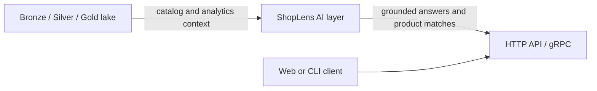

# AI layer (ShopLens)

The AI package is an optional layer in `src/vnecom/ai`. ShopLens provides browser chat, fixed analytics, lexical product retrieval, structured Deal hunt and an OpenAI-compatible adapter. See [Deal hunting and pipeline coverage](deal-hunting.md) for voucher arithmetic, historical ingestion, quality gates, reconciliation, indexing and offline evaluation. Semantic product retrieval, cross-platform matching, live-model evaluation and gRPC remain separate work.

## Run platform chat

Install the optional dependencies and run the synthetic platform pipeline first:

```bash
.venv/bin/python -m pip install -e '.[lite,ai]'
export VNECOM_TABLE_FORMAT=parquet
export SPARK_MASTER='local[2]'
export SPARK_LOCAL_IP=127.0.0.1
make demo DAYS=3
```

Configure these variables in the process environment (the AI settings do not read `.env`):

| Variable | Purpose |
|---|---|
| `VNECOM_AI_ENABLED=true` | Enable chat calls |
| `VNECOM_AI_BASE_URL` | OpenAI-compatible base URL ending in `/v1`; defaults to `https://api.openai.com/v1` |
| `VNECOM_AI_MODEL` | Exact model ID advertised by the provider; defaults to `gpt-4o-mini` |
| `VNECOM_AI_API_KEY` | Provider credential, supplied securely through environment settings |
| `VNECOM_AI_API_KEY_REQUIRED=false` | Explicitly allow a keyless local runtime; defaults to true |
| `VNECOM_AI_MAX_CONTEXT_CHARS` | Maximum combined system/history/question characters; defaults to 60,000 |

Gemma and GPT-OSS can be used when their serving runtime exposes the same chat-completions protocol. Their names and availability depend on the runtime; no weights or local model server are installed by the AI extra. Local model selection and serving can be added later without changing the chat UI.

```bash
.venv/bin/vnecom ai serve --host 127.0.0.1 --port 8000
```

The root page serves a Codex-style chat interface with a conversation sidebar, fixed composer, suggested questions, Enter-to-send and Shift+Enter for new lines. Conversations are saved in this browser's local storage; they can be deleted from the header. No server-side conversation storage is provided.

The interface defaults to **Platform data** mode, which works without a model or API key. `POST /chat/data` routes supported analytics to fixed queries, product questions to the index, and voucher questions to Deal hunt. Latest-date or explicitly requested-date reports use actual gold metrics but do not interpret arbitrary questions and are explicitly labeled as using no LLM. `GET /chat/status` reports gold-data availability separately from model configuration. An unconfigured model is disabled in the mode picker instead of failing every message.

`GET /health` checks the API process. `GET /ready` checks model configuration and readable gold metrics; it does not call or verify the model provider. In **Model** mode, `POST /chat` accepts `{"message":"Compare platform GMV on the latest date", "history":[]}` and returns `answer`, `model`, and `context_source`. History permits only user/assistant turns, with at most 20 messages and 8,000 characters per message. Product/deal/unsupported intents use deterministic routing instead of letting the model invent listing details. Date-specific analytics use that date's evidence. Sending can be stopped in the browser; this cancels waiting for the response but may not stop an upstream provider request already in progress.

Analytics use a fixed read-only query from `gold.mart_platform_source_daily` (legacy `gold.mart_platform_daily` before rebuilding), limited to 14 recent dates or one explicitly requested date and 200 rows. The source-separated mart avoids blending synthetic and live metrics and selects the first configured non-synthetic source by default. Chat executes no model-generated SQL and sends only the analytics context and conversation history to the configured model endpoint. Product candidates come from the local index, not aggregate metrics. The system prompt requests source/date citations and distinguishes unknown values from zero. Model accuracy still requires review; tracked listings are not verified market-wide coverage.

Missing configuration/data returns 503, provider errors return 502, provider timeouts return 504, and an oversized model context returns 413 before calling a provider. Keep the development service bound to loopback: authentication and multi-user persistence are not implemented. `vnecom ai probe` checks a real configured provider with a small greeting request and no platform data.

Run `.venv/bin/python -m pytest -q tests/ai/test_chat_api.py` for API/provider-contract tests. These use a mocked compatible endpoint and require no model or API key; they do not establish live model availability.



> **Demo:** [ShopLens demo GIF — placeholder]

Run the current P0 text-generation path with one command after setting `VNECOM_AI_API_KEY`:

```bash
.venv/bin/python -c 'from vnecom.ai.interfaces.factory import build_text_pipeline; print(build_text_pipeline().run("Summarize the e-commerce data platform").text)'
```

## P0 text-generation flow

`TextPipeline` delegates to `TextAgent`, which creates a validated `GenerationRequest` for the `GenerateText` use case. The use case calls the `ModelPort` and rejects empty model output. `build_text_pipeline()` composes this flow with `OpenAICompatibleModel` and environment-backed `AISettings`.

The adapter sends a non-streaming `POST {base_url}/chat/completions` request with a bearer API key. It supports user/assistant history and returns generated text, model, token usage when supplied, and finish reason. The adapter supports context management and only closes HTTP clients it created itself.

## Configuration

AI settings use the `VNECOM_AI_` environment prefix. Defaults are disabled, provider `openai-compatible`, base URL `https://api.openai.com/v1`, model `gpt-4o-mini`, and timeout 60 seconds. Set `VNECOM_AI_API_KEY` in the environment; do not put secrets in `config/ai.yaml` or source control. `VNECOM_AI_SYSTEM_PROMPT` can supply an optional system prompt. Empty environment values are ignored.

The generation request defaults to temperature `0.0`; temperature must be from 0 through 2, and `max_tokens`, when set, must be positive. A request can override the configured model.

## Optional dependencies and CLI

The core text-generation adapter uses the project's existing `httpx` dependency. Install the `ai` extra (`pip install 'vnecom[ai]'`) for optional service dependencies. CLI commands are exposed under `vnecom ai`: `serve` runs browser/API chat, `embed` runs the configured embedding job, while `grpc`, `eval`, and `match` report that they are not implemented.

The CLI imports no optional AI frameworks at module import time. This keeps the data-platform CLI usable without installing the AI extra.

## Phase roadmap

| Phase | Scope | Status |
|---|---|---|
| P0 — foundation | Domain contracts, configuration, OpenAI-compatible text adapter, composition root, CLI placeholders, documentation | Complete |
| P1 — usable assistant | Aggregate gold-context browser/API chat and embedding pipeline implemented; product retrieval, gRPC, entity resolution, evaluation and operational measurements remain | Partial |
| Later | Production hardening, expanded model/provider support, and user-facing demo | Not scoped |

## Evaluation and performance placeholders

Populate these tables with measured results when P1 evaluation and workloads exist. Do not treat placeholders as benchmarks.

### Evaluation

| Dataset / task | Metric | Result | Notes |
|---|---|---|---|
| _TBD_ | _TBD_ | _TBD_ | _TBD_ |

### Entity resolution (ER)

| Dataset | Precision | Recall | F1 | Notes |
|---|---:|---:|---:|---|
| _TBD_ | _TBD_ | _TBD_ | _TBD_ | _TBD_ |

### Latency

| Workload | p50 | p95 | p99 | Environment / notes |
|---|---:|---:|---:|---|
| _TBD_ | _TBD_ | _TBD_ | _TBD_ | _TBD_ |

Domain types describe products, listings, citations, and answers, but do not imply implemented product retrieval. Add persistence, authentication, evaluation, and operational guarantees before exposing chat as a production assistant.
