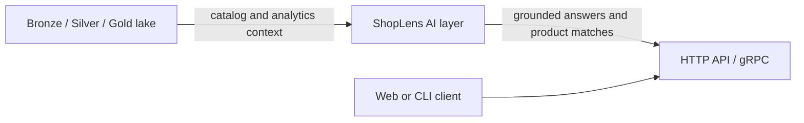

# AI layer (ShopLens)

The AI package is an optional, additive layer in `src/vnecom/ai`. The P0 foundation provides framework-free domain objects, a small text-generation application flow, and an OpenAI-compatible chat-completions adapter. It does not yet provide product-question answering, retrieval, embeddings, product matching, evaluation, or a running API/gRPC service.



> **Demo:** [ShopLens demo GIF — placeholder]

Run the current P0 text-generation path with one command after setting `VNECOM_AI_API_KEY`:

```bash
.venv/bin/python -c 'from vnecom.ai.interfaces.factory import build_text_pipeline; print(build_text_pipeline().run("Summarize the e-commerce data platform").text)'
```

## P0 text-generation flow

`TextPipeline` delegates to `TextAgent`, which creates a validated `GenerationRequest` for the `GenerateText` use case. The use case calls the `ModelPort` and rejects empty model output. `build_text_pipeline()` composes this flow with `OpenAICompatibleModel` and environment-backed `AISettings`.

The adapter sends a non-streaming `POST {base_url}/chat/completions` request with a bearer API key. It returns generated text, model, token usage when supplied, and finish reason. The adapter supports context management and only closes HTTP clients it created itself.

## Configuration

AI settings use the `VNECOM_AI_` environment prefix. Defaults are disabled, provider `openai-compatible`, base URL `https://api.openai.com/v1`, model `gpt-4o-mini`, and timeout 60 seconds. Set `VNECOM_AI_API_KEY` in the environment; do not put secrets in `config/ai.yaml` or source control. `VNECOM_AI_SYSTEM_PROMPT` can supply an optional system prompt. Empty environment values are ignored.

The generation request defaults to temperature `0.0`; temperature must be from 0 through 2, and `max_tokens`, when set, must be positive. A request can override the configured model.

## Optional dependencies and CLI

The core text-generation adapter uses the project's existing `httpx` dependency. Install the `ai` extra (`pip install 'vnecom[ai]'`) for optional service dependencies. CLI commands are exposed under `vnecom ai`; at P0, `embed`, `grpc`, `eval`, and `match` report that they are not implemented. `serve` is a P1 placeholder that requires the optional API dependencies; the API factory is not implemented.

The CLI imports no optional AI frameworks at module import time. This keeps the data-platform CLI usable without installing the AI extra.

## Phase roadmap

| Phase | Scope | Status |
|---|---|---|
| P0 — foundation | Domain contracts, configuration, OpenAI-compatible text adapter, composition root, CLI placeholders, documentation | Complete |
| P1 — usable assistant | Lake-grounded question answering and citations; HTTP API and gRPC; corpus embedding and retrieval; product entity resolution; evaluation and operational measurements | Planned |
| Later | Production hardening, expanded model/provider support, and user-facing demo | Not scoped |

## Evaluation and performance placeholders

Populate these tables with measured results when P1 evaluation and workloads exist. Do not treat placeholders as benchmarks.

### Evaluation

| Dataset / task | Metric | Result | Notes |
|---|---|---|---|
| _TBD_ | _TBD_ | _TBD_ | _TBD_ |

### Entity resolution (ER)

| Dataset | Precision | Recall | F1 | Notes |
|---|---:|---:|---:|---|
| _TBD_ | _TBD_ | _TBD_ | _TBD_ | _TBD_ |

### Latency

| Workload | p50 | p95 | p99 | Environment / notes |
|---|---:|---:|---:|---|
| _TBD_ | _TBD_ | _TBD_ | _TBD_ | _TBD_ |

Domain types already describe products, listings, citations, and answers, but those types do not imply implemented retrieval or query behavior. P1 includes the API and gRPC services, embedding/index pipeline, grounded question answering, cross-platform product matching, and evaluation. Add persistence, safety controls, and operational guarantees alongside those capabilities rather than treating the P0 text adapter as a production assistant.
